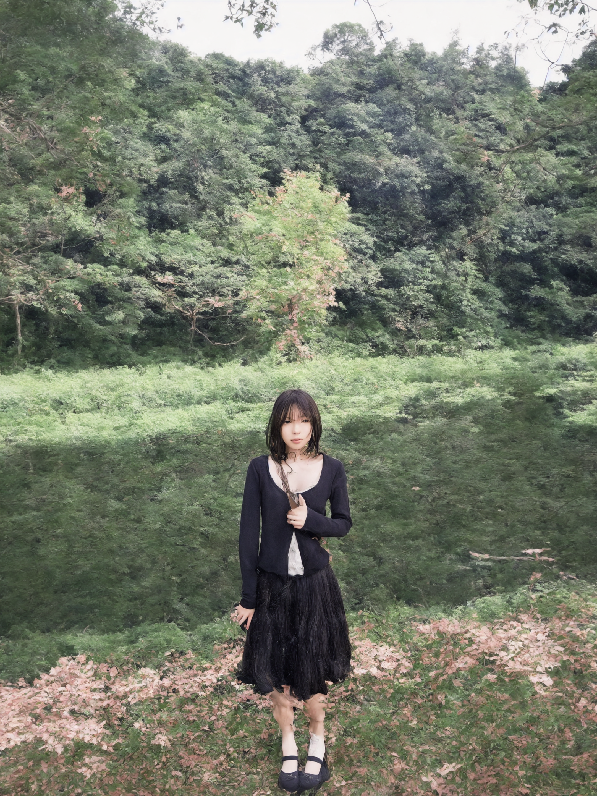
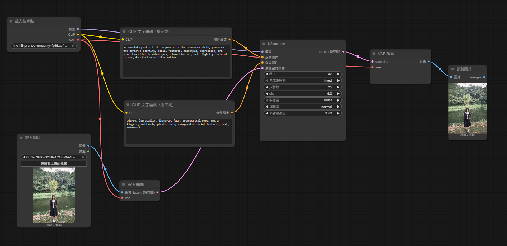

# AI 圖像生成紀錄

這個專案記錄使用 ComfyUI 進行 AI 圖像生成的過程，包含原圖、生成結果、工作流、提示詞與個人心得。

## 原圖

## 生成的圖

## 完整工作流

## 使用的提示詞

### 正向提示詞

> anime-style portrait of the person in the reference photo, preserve the person's identity, facial features, hairstyle, expression, and pose, beautiful detailed eyes, clean line art, soft lighting, natural colors, detailed anime illustration

### 負向提示詞

> blurry, low quality, distorted face, asymmetrical eyes, extra fingers, bad hands, plastic skin, exaggerated facial features, text, watermark

## 個人心得

這次課程讓我學會使用 ComfyUI，並嘗試用自己的照片生成圖像。過程中我發現提示詞不容易拿捏，生成結果也和原圖有明顯差異，有些細節看起來不自然。之後我想多練習調整提示詞與參數，讓生成結果更接近預期、整體更協調。

